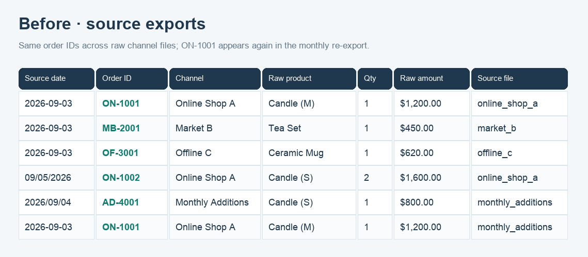
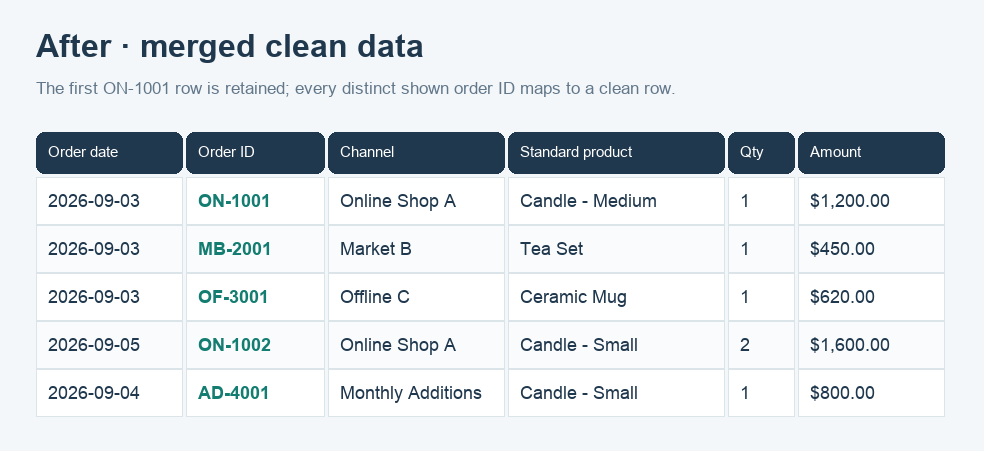
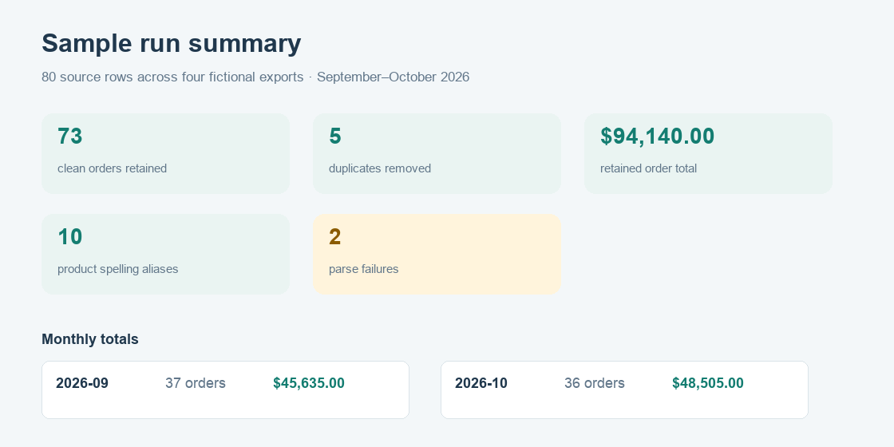

# Messy Exports Merger
월별·채널별 주문 CSV를 표준화해 요약과 변경 이력이 포함된 XLSX로 합칩니다.

Merge inconsistent monthly and channel order exports into one clean workbook with summaries and a reviewable change log.

<p align="center"></p>

## What it does

- Reads CSV files with different header names, date formats, and currency strings.
- Maps source headers and product spellings through editable CSV configuration files.
- Removes repeated exports by normalized order ID, channel, and date; the first read row is retained and logged.
- Creates clean data, product and month summaries, a change log, and an unmatched product list.

## Quick start

```bash
python3 -m pip install -r requirements.txt
python3 merge.py samples/ -o examples/output/merged.xlsx
python3 -m unittest discover -s tests
```

## Input to output

Put source `.csv` files in an input folder. Each file needs columns mapped to order date, order ID, channel, product name, quantity, and amount. Edit [`config/mapping.csv`](config/mapping.csv) to recognize more header names, [`config/products.csv`](config/products.csv) for canonical product names, and [`config/product_aliases.csv`](config/product_aliases.csv) to add product spellings. Exact standard names match the catalog directly. The program writes a five-sheet workbook. See the [sample output](examples/output/merged.xlsx).



## Processing rules

| Area | Rule |
| --- | --- |
| Header mapping | Match source headers after ignoring letter case, spaces, and punctuation. Configure each source spelling in `config/mapping.csv`. |
| Dates | Accept ISO dates, US month/day/year dates, dotted dates, slash dates, and compact `YYYYMMDD` dates. |
| Amounts | Parse plain numbers, comma separators, common currency symbols, and `원`. Parentheses indicate a negative amount. |
| Duplicate rows | Remove a fully repeated row from the same channel export, or a row with the same normalized order ID, channel, and date. Keep the first read row and record both source locations in Change Log. Monthly additions are read after the base exports. |
| Product catalog and aliases | Match standard names from `config/products.csv` directly. Resolve aliases after ignoring case, spaces, and punctuation. Only names missing from both the catalog and aliases appear in Unmatched. |
| Invalid records | Keep blank rows out of the clean data. Log blank rows and rows with invalid required values in Change Log. |

## Use this for your data

This is suited to combining recurring sales or order exports that use inconsistent headers and product labels. Try the sample structure first, then use a copy of your real files with sensitive information removed before adapting the mapping and aliases.

## Scope and limitations

The tool reads CSV files only and expects one row per order. It does not infer missing order IDs, reconcile partial shipments, convert currencies, or choose between conflicting rows sharing an order ID, channel, and date. For those conflicts it keeps the first valid row in the input read order and logs the decision. The fictional samples contain 80 source rows across four exports for September and October 2026, including five repeated orders, ten product spelling variants, and two parse failures. The sample is not real transaction data. This is a data-cleaning utility, not accounting, tax, or legal advice.

## Tests

Run `python3 -m unittest discover -s tests` after installing `requirements.txt`. Tests cover supported date and amount formats, catalog and alias matching, date-aware duplicate handling and first-row retention, workbook sheets, and reconciled totals. Current sample output retains 73 rows totaling $94,140.00.

## Related project

[Spreadsheet Template Pipeline](https://github.com/yong3750/spreadsheet-template-pipeline)

## Live demo

[Open the static demo](https://yong3750.github.io/messy-exports-merger/)
